 

### `sarthak@github ~ $ whoami`

<table>
  <tr>
    <td width="42%" align="center" valign="middle">
      
    </td>
    <td width="58%" align="center" valign="middle">
      
    </td>
  </tr>
</table>

 

### `sarthak@github ~ $ cat pbel.md`

<b>Gaussian Noise Simulation and Comparative Restoration Using Five Spatial Filtering Techniques</b>

My PBEL (Project Based Experiential Learning) project at DES Pune University. 
We added Gaussian noise to a test image at four strengths, cleaned it with five classic filters, and scored each one.

Wiener won overall at 24.85 dB average PSNR. Bilateral was best at the lowest noise (28.41 dB) but fell apart as the noise grew. 
Gaussian smoothing came second and edged out Wiener at the highest noise level.

MATLAB, Image Processing Toolbox, PSNR and MSE. Built with Vaibhav Kale, Pranav Keswad and Suyash Kshirsagar. My part was noise modelling and the MATLAB simulation.

### `sarthak@github ~ $ ./projects.sh`

<table>
  <tr>
    <td width="50%" valign="top">
      <h4><a href="https://github.com/sarthakshinde8022?tab=repositories&q=eco-eye">ECO-EYE</a></h4>
      
An IoT security system running on embedded hardware. My flagship project.

      Embedded C, IoT
    </td>
    <td width="50%" valign="top">
      <h4><a href="https://github.com/sarthakshinde8022?tab=repositories&q=jaybot">JayBot</a></h4>
      
A Discord RPG bot themed on the Maratha Empire.

      Discord, RPG
    </td>
  </tr>
  <tr>
    <td width="50%" valign="top">
      <h4><a href="https://github.com/sarthakshinde8022?tab=repositories&q=fleet">Fleet Logbook</a></h4>
      
A database for tracking trucking fleets and their routes.

      DBMS
    </td>
    <td width="50%" valign="top">
      <h4><a href="https://github.com/sarthakshinde8022/dehazing_derainig_fft_">Derain Dehazing</a></h4>
      
Removes haze and rain from images with FFT-based filtering.

      Digital Image Processing, FFT
    </td>
  </tr>
  <tr>
    <td width="50%" valign="top">
      <h4>Gaussian Noise</h4>
      
Compares five spatial filters at removing Gaussian noise from images, scored by PSNR and MSE.

      MATLAB, PBEL
    </td>
    <td width="50%" valign="top">
      <h4>Art3mis</h4>
      
CODM gaming content for Hindi-English audiences on Instagram and YouTube.

      Content creation
    </td>
  </tr>
</table>

<a href="https://github.com/sarthakshinde8022?tab=repositories">See all repositories</a>

### `sarthak@github ~ $ ./contributions.sh`

The heatmap above refreshes itself through GitHub Actions.

Social links:

